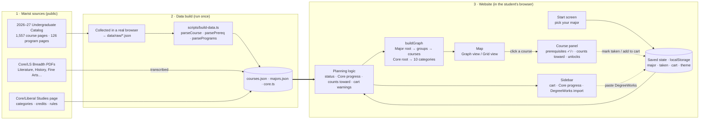
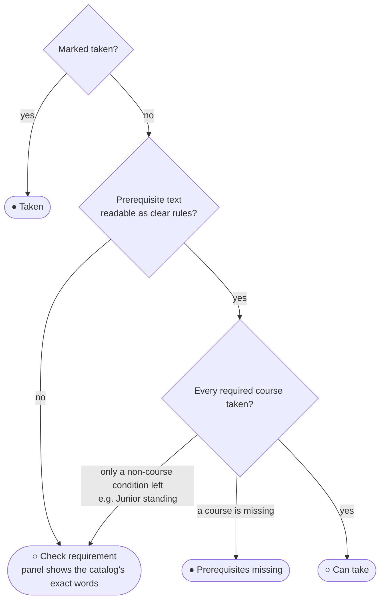

# How maristMap works

## The whole system

## How a course gets its status

## Explained for someone who has never seen it

**The problem.** At Marist, planning next semester means juggling three places: DegreeWorks tells you what you still need, College Scheduler builds your week, and the catalog holds each course's prerequisites, one page at a time. None of them show the whole picture, so students take courses that don't count. A common example: a literature course that isn't on the Core Literature list, which costs an extra class later.

**What you see first.** You open maristMap, pick your major from a dropdown (all 82 majors and concentrations), and press *Show my map*.

**The map.** Two clusters appear:
- **On the left, your major.** A big red dot is your major. Around it are its requirement sections ("The Finance Core", "Required Elective Courses"…), and around each section, its courses as small dots.
- **On the right, the Core.** A second red dot, *Core requirements*, with the 10 Core categories every Marist student must complete (Literature, History, Mathematics…) arranged around it like a wheel.

Thin red lines connect a course to the courses that require it, so you can follow a path from an intro course to the upper-level ones it opens up.

**What the dots mean.**
- **Solid red** — you've taken it.
- **Red ring** — you can take it now: every prerequisite is done.
- **Gray ring** — check the requirement: something like "Junior standing" or "permission of instructor" that the app can't verify.
- **Solid gray** — a prerequisite is missing.

A Core category fills in once one of your courses satisfies it.

**Telling it what you've taken.** Either click a course and press *Mark as taken*, or open *Import from DegreeWorks* in the sidebar and paste your audit. The app finds every course code, shows a checklist so you can untick anything in progress, and marks the rest. The map recolors immediately: courses you've unlocked turn into red rings.

**Clicking a course** opens a panel with:
- its title, credits, and when it's offered
- its prerequisites as ✓ / ○ chips (clicking one jumps to that course)
- **Counts toward** — which part of your major and which Core category it satisfies, with a warning when a course is cross-listed (Marist counts it toward only one Core category)
- what it **unlocks** next, and a link to the official catalog page

**Planning.** *Add to cart* builds a list for next semester. The sidebar totals the credits and warns if a cart course still needs a prerequisite. The sidebar also shows Core progress ("3 of 10"), with each category linked to Marist's official list.

**Other views.** *Grid* shows the same thing as cards grouped by section ("2 of 7 taken"). *Departments* regroups the map by department instead of by requirement. The fox switch in the corner flips between white and Marist-red themes.

**Where the data comes from.** Everything is Marist's own public information: the 2026–27 course catalog (1,557 courses and 126 program pages) and the official Core lists. We collected it once and turned it into clean data files that ship with the site. When a prerequisite can't be read as a clear rule, the app shows the catalog's exact wording instead of guessing. Nothing about you is sent anywhere: your courses and cart are saved in your own browser.

**What's next.** Section times and a weekly schedule builder, signing in with a Marist account, and Core Pathways.
